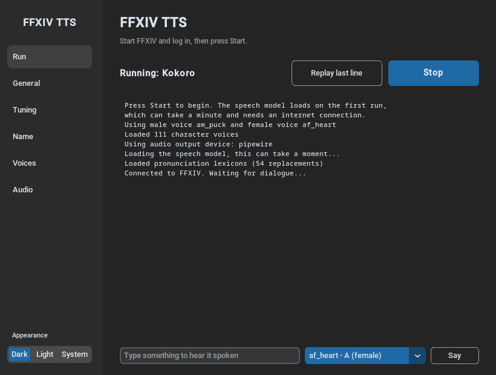
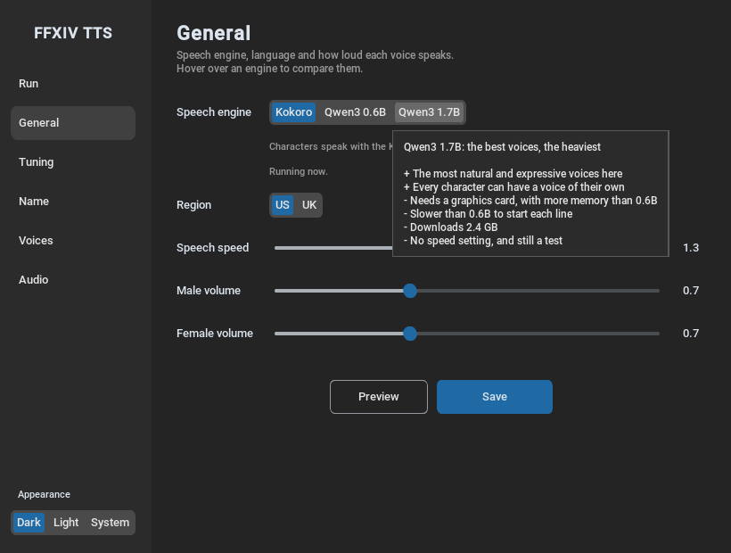
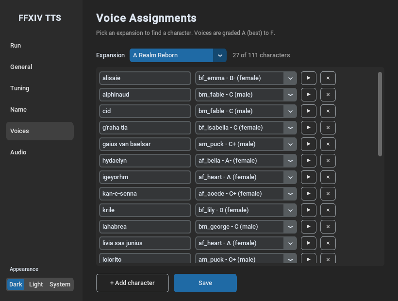
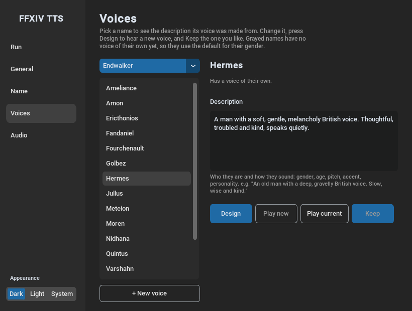
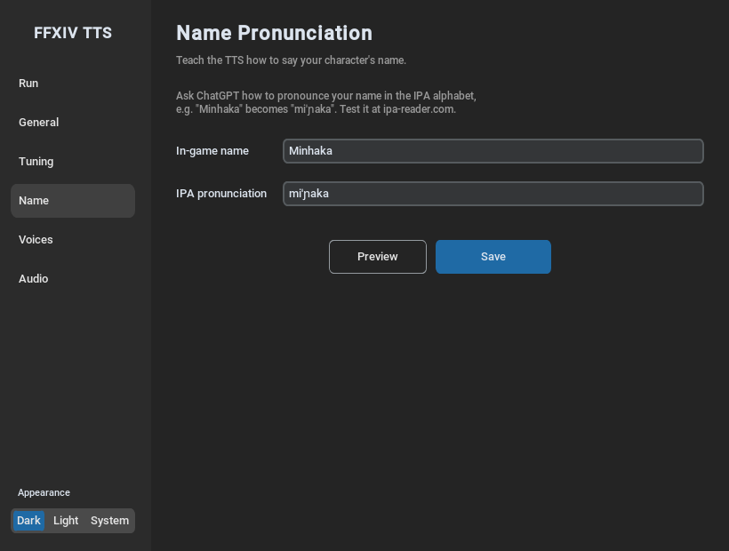
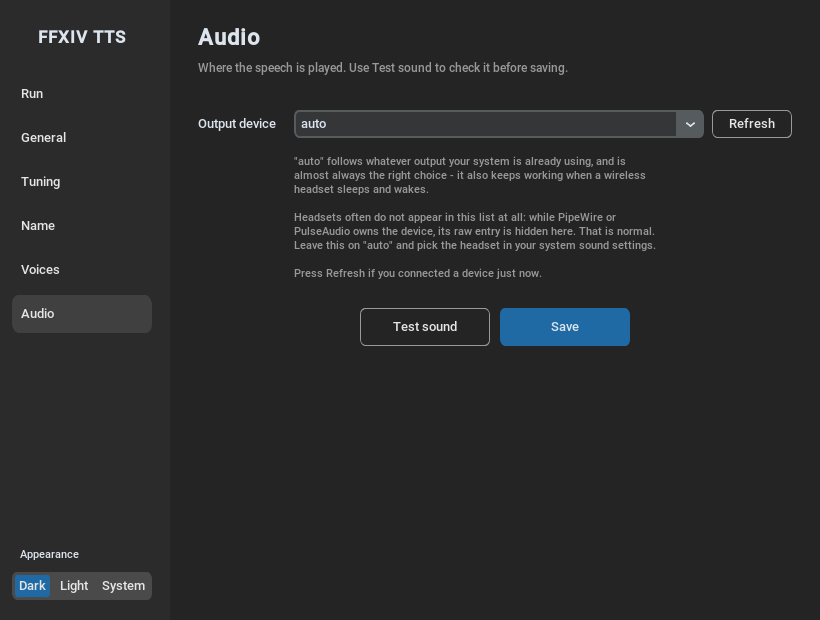

# FFXIV TTS

**Hear Final Fantasy XIV's dialogue read aloud.** FFXIV TTS gives the NPCs voices: over a
hundred main characters each have a voice picked for them, and everyone else gets a male or
female voice. It runs on your own PC. There's no account to make and nothing to pay for.

---

## What you need

- **Final Fantasy XIV on Windows or Linux**, started with **XIVLauncher**, the community
  launcher that adds plugins to the game. Step 1 below shows how to get it.
- **The TextToTalk plugin**, installed from inside the game (step 2). It hands the dialogue to
  FFXIV TTS.
- **An internet connection the first time** you press Start, to download the voices
  (about 330 MB). After that, FFXIV TTS works offline.
- No graphics card needed: the standard voices run on any normal computer.

---

## Setup (about 10 minutes)

### Step 1: Install XIVLauncher

Skip this step if you already start the game with XIVLauncher.

1. Download XIVLauncher from [goatcorp.github.io](https://goatcorp.github.io) and install it.
2. Open it and log in with your FFXIV account, as you would with the normal launcher.

### Step 2: Set up TextToTalk in the game

1. Start the game with XIVLauncher and log in to a character.
2. Type `/xlplugins` in the chat box and press Enter. The plugin installer opens.
3. Search for **TextToTalk**, then press **Install**.
4. Type `/tttconfig` in the chat box to open TextToTalk's settings.
5. Change the **voice** to **WebSocket**.
6. Change the **port** to **51363**.
7. Choose what you want read out: NPC dialogue, party chat, /say and so on.

### Step 3: Download FFXIV TTS

1. Download the zip for your computer:
   - **Windows:** [ffxiv-tts-windows.zip](https://github.com/MinhakaDev/FFXIV-TTS/releases/latest/download/ffxiv-tts-windows.zip)
   - **Linux:** [ffxiv-tts-linux.zip](https://github.com/MinhakaDev/FFXIV-TTS/releases/latest/download/ffxiv-tts-linux.zip)
2. Unzip it. On Windows: right-click the zip, choose **Extract All…**, then **Extract**.
3. Move the folder somewhere it can stay, such as Documents. Keep everything in it together:
   the app keeps its voices and your settings in the folders next to it.

### Step 4: Start it

**Windows:** open the folder and double-click **`ffxiv-tts.exe`**. If Windows says
*"Windows protected your PC"*, click **More info**, then **Run anyway**. Windows shows this
for apps that aren't signed with a paid certificate, which is usual for small free apps.

**Linux:** first install two audio libraries, once, by pasting the line for your system into a
terminal:

| System | Command |
| --- | --- |
| Ubuntu, Mint, Debian, Pop!_OS | `sudo apt install libportaudio2 libsndfile1` |
| Fedora | `sudo dnf install portaudio libsndfile` |
| Arch, Manjaro, EndeavourOS | `sudo pacman -S portaudio libsndfile alsa-lib` |

Then double-click **`ffxiv-tts`** in the folder. If it doesn't open, right-click it, open
**Properties**, and allow it to run as a program (or run `./ffxiv-tts` in a terminal from
that folder).

**Then press Start.** The first time, it downloads the voices, which takes a minute or two.
When the window says **Connected to FFXIV. Waiting for dialogue...**, you're done: talk to
an NPC and listen.

---

## The app, screen by screen

The sidebar on the left switches between screens. Changes on most screens take effect once you
press **Save**.

### Run

The screen in the picture at the top of this page.

- **Start** and **Stop** turn the voices on and off. The game can be open or closed when you
  press Start: the app keeps trying to connect until the game is there.
- **Replay last line** says the last line of dialogue again.
- **The box at the bottom** speaks whatever you type, so you can try out a voice.
- **The text area** shows what the app is doing. Each line of dialogue appears there as
  it's spoken.

### Recent: who just spoke

Everyone who has spoken since you opened the app, the latest at the top, with what they said
last. When a voice doesn't suit someone, change it here instead of looking for them on the
Voices screen.

- With **Kokoro**, pick another voice from their list. It's saved straight away, and they
  speak with it from their next line. **▶** plays what they last said in the voice on their
  row, so you can try a few.
- With **Qwen3**, **▶** plays their last line again, and **Design** opens the Voices screen on
  them to make them a voice of their own.

Next to each name it says where their voice comes from: *voice assigned* (*own voice* with
Qwen3) when it was chosen for them, or *picked by race* or *picked by name* when the app
picked it.

### General: the speech engine and volume

- **Speech engine** chooses the voices. **Kokoro** is the standard one: quick, light, and fine
  on any computer. **Qwen3** voices sound more natural, but they're still a test and need a
  graphics card. Rest the mouse on an engine to see how they compare. Clicking an engine
  switches to it straight away.
- **Region** gives Kokoro's voices an American (US) or British (UK) accent.
- **Speech speed** and the **volume** sliders set how fast and how loud the voices are.
  Kokoro and Qwen3 each keep their own speed, since they speak at different paces. Qwen3's
  goes up to 1.6, and is only approximate: its voices speak a little slower than the number
  says, and it varies a bit from line to line.
  **Preview** lets you hear them before you press Save.

### Voices: who speaks with which voice

With **Kokoro**, each character is given one of Kokoro's voices. Pick an expansion to find a
character, choose a voice from their list, and press **▶** to hear them. Voices are graded from
A (best) to F. **+ Add character** adds anyone missing. Press **Save** when you're done.
Anyone not on the list gets a voice that suits their race, or a child's or an old person's,
picked from their name so they sound the same every time you meet them.

With **Qwen3**, every character gets a voice of their own, made from a written description.
Pick a name to see the description. To change their voice, edit the description, press
**Design** to hear a new voice made from it, and press **Keep** when you like it.
**Play current** plays the voice they have now. Anyone without a voice of their own gets one
of their race's voices, picked from their name so they sound the same every time you meet
them. You'll find those under *Races*, with the voices for children and old people, and you
can redesign them like any other. **Default female** and **Default male**, under *Defaults*,
speak lines that come without a name.

### Name: how your character's name is said

Type your character's name and how it's pronounced, then press **Preview** to hear it and
**Save** to keep it.

- **Kokoro** wants the pronunciation in IPA, the phonetic alphabet. Ask ChatGPT
  *"How do you say Minhaka in IPA?"* and check the answer at
  [ipa-reader.com](https://ipa-reader.com).
- **Qwen3** wants it spelled the way it sounds, such as *Mee-nyah-ka*.

### Tuning

Kokoro only. Makes one voice louder, quieter, faster or slower than the rest.

### Audio: where the sound comes out

Leave the device on **auto**: it plays through whatever your computer is already using. Press
**Test sound** to check. You should hear a short beep.

---

## Updating

When a new version is out, a banner appears on the Run screen with a **Download** button.

1. Download the new zip.
2. Unzip it **into the same folder** as before, and choose **Replace** when asked.

Your settings, your choice of voice for each character and your name's pronunciation are kept.
If you designed Qwen3 voices yourself, copy the `qwen3-voices` folder somewhere safe first:
the update replaces it with the release's own voices.

---

## Something's not right?

**The window says "Could not reach FFXIV".**
FFXIV TTS can't find TextToTalk. Check that:
- the game was started with XIVLauncher,
- TextToTalk is installed and turned on (type `/toggletts` in game to turn it on or off),
- TextToTalk's voice is set to WebSocket and its port to 51363.

The app tries again every 5 seconds, so you don't need to restart it.

**It says "Connected", but I hear nothing.**
Go to the **Audio** screen and press **Test sound**. No beep? Check your computer's volume and
that the right speakers or headset are selected in your system's sound settings. Leave the
device on **auto**.

**Windows deleted the app, or my antivirus warns about it.**
Some antivirus programs distrust any new app that isn't signed. The app is built automatically
from the code in this repository. You can allow it in your antivirus, or build it yourself (see
below).

**A name or word is said wrong.**
For your own character, use the **Name** screen. For anyone else, the pronunciation lists are
in the `lexicons` folder; see [lexicons/README.md](lexicons/README.md).

**Qwen3 is slow, or stops between sentences.**
Qwen3 needs a graphics card. Without one, switch back to **Kokoro** on the General screen.

**Linux: my headset isn't in the Audio list.**
That's normal: leave it on **auto** and pick the headset in your system's sound settings. If
the list has no `pipewire` or `pulse` entry at all, install your sound server's ALSA bridge:
`pipewire-alsa` on most systems (`libasound2-plugins` on older Debian and Ubuntu).

**Still stuck?** [Open an issue](https://github.com/MinhakaDev/FFXIV-TTS/issues) and describe
what happened. A copy of the text from the Run screen helps a lot.

---

## Why I made this

To make FFXIV more immersive, and easier to enjoy for anyone who'd rather listen than read:
for accessibility, immersion, or just for fun.

## For developers

Running from source, building the app and how releases are published:
[docs/DEVELOPING.md](docs/DEVELOPING.md).

## License

[MIT](LICENSE). The voices come from [Kokoro](https://huggingface.co/hexgrad/Kokoro-82M) and
[Qwen3-TTS](https://huggingface.co/Serveurperso/Qwen3-TTS-GGUF). The pronunciation lists come from
[TextToTalk](https://github.com/karashiiro/TextToTalk/tree/main/lexicons).
